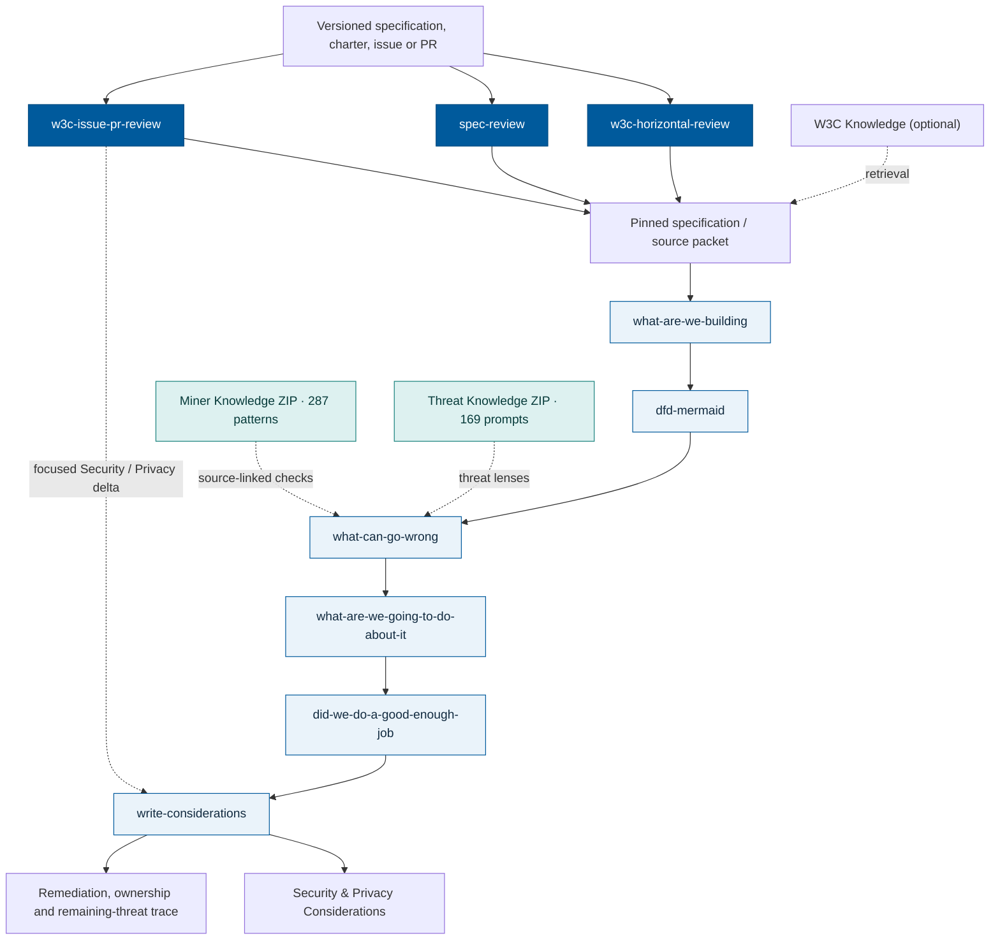

# Web Standards Review

Web Standards Review is a public-beta marketplace for portable standards review and threat-modeling skills maintained independently by Simone Onofri. It is informed by Web standards and W3C work, but it is not an official W3C deliverable.

Generated outputs are not W3C, Working Group, Interest Group, TAG, or horizontal-review conclusions unless adopted through the applicable process. Technical validation is not publication approval, and generated outputs remain subject to human review.

## Workflow architecture

The entrypoint selects the review scope. Skills share source-pinned artifacts
(model, DFD, threats, ERTA responses, and evidence) rather than treating a
catalog question as a finding.



The five modeling steps keep their original order. The authoring extension
[`write-considerations`](skills/write-considerations/SKILL.md)
follows the adequacy comparison—or can be proposed for a focused
Security/Privacy PR—using the chain **threat → ERTA response → remediation
location → responsible actor → remaining threat**. An issue or PR need not
run the full model to request a bounded editorial update.

When the optional W3C Knowledge service is unavailable, the skills use an
existing versioned source packet or retrieve the public specification, plus
the two packaged [offline knowledge caches](cache/README.md). The cache
supplies questions and patterns for analysis, not the source specification
or completed findings.

## Skill inventory

The public beta contains **20 portable skills**, including issue/PR review, the five-stage threat-modeling flow, specification and horizontal-review orchestration, the `write-considerations` authoring extension, and the specialized extraction and implementation layers. The optional local W3C Knowledge service supports lexical, vector and hybrid retrieval with a CPU model. Personal libraries, model weights and database contents are not included.

Choose an entrypoint for the task:

| Starting point | Skill | Result |
| --- | --- | --- |
| A standards issue, PR, reviewer comment, or closure request | `w3c-issue-pr-review` | Thread context, supported recommendation, and concise response draft |
| A specification finding or threat-modeling task | `spec-review` | Focused finding reply or coordinated modeling flow |
| A complete specification or charter horizontal review | `w3c-horizontal-review` | Target-specific analysis, domain coverage, and resolution trace |

`w3c-issue-pr-review` handles ordinary thread review directly. It can call the charter, specification, or implementation skills for a bounded question, then use their evidence to prepare the reply. The specialist result retains its coverage limits and does not authorize posting or closure. The skill also works with supplied primary evidence when optional skills or services are unavailable. See its [integration guide](skills/w3c-issue-pr-review/references/marketplace-integration.md) for routes and handoff contents.

For a bounded design or drafting question, use the relevant miner's author-support mode. It returns source-linked author actions and tests without automatically starting a full review or editing the draft. See [author support](docs/author-support.md).

Core flow:

1. `what-are-we-building`;
2. `dfd-mermaid`;
3. `what-can-go-wrong`;
4. `what-are-we-going-to-do-about-it`;
5. `did-we-do-a-good-enough-job`.

Extensions:

6. `threat-card-generator`;
7. `fact-check`.

Full elicitation runs also retain a versioned candidate ledger: frozen observations remain separate from final threat IDs, rejected candidates stay visible, and reconciliation is checked against exact model and threat-package bytes. See the [candidate ledger contract](skills/what-can-go-wrong/contracts/candidate-ledger-v1.md).

Use `spec-review` to choose a focused finding reply or coordinate the complete flow. It includes evidence, local proof-of-concept, report, and publication-gate validators. Start with the exact specification snapshot and keep review outputs outside this repository.

Use `w3c-horizontal-review` for the complete specification or charter workflow. It connects `w3c-webappsec-miner`, `whatwg-miner`, `w3c-spec-miner`, `w3c-security-pattern-miner`, `w3c-horizontal-review-patterns-miner`, `standards-vulnerability-intel-miner`, `strategy-charter-miner`, `threat-knowledge`, and `w3c-spec-code`. Checklist verification, independent elicitation and implementation mapping remain separate until reconciliation. See [horizontal workflows](docs/horizontal-workflows.md) for the portable boundaries and retained coverage states.

`bundles/threat-modeling-flow-v1.json` pins the ordered flow, contracts, component sources, host projections, fixtures, and required tests. `catalog.yaml` is the install authority; an unlisted skill is not installable.

Catalog **version 5** adds `write-considerations` as the twentieth skill, along with the Miner and Threat Knowledge offline caches and their source-linked reconciliation. The five modeling stages keep their existing order. See [bundle structure](bundles/README.md).

## Beta interface

Run the repository-local tool as `./tools/reviewctl/reviewctl`:

```text
reviewctl catalog
reviewctl install --skill <id> --host codex|claude|all [--dry-run]
reviewctl install --bundle threat-modeling-flow-v1 --host codex|claude|all [--dry-run]
reviewctl status
reviewctl update [--dry-run]
reviewctl uninstall --host codex|claude|all [--dry-run]
```

For issue/PR review only, use `reviewctl install --skill w3c-issue-pr-review --host codex` (or `claude`). Install the complete bundle to make all specialist routes available. For example, ask: “Use w3c-issue-pr-review to check this PR against its linked issue and draft a concise response.”

Installation exports the selected clean commit into a separate snapshot and creates reversible host symlinks to it. Shared contracts, scripts, and provider code travel with the skills. Checkout edits have no effect until `update` accepts the new commit. The lock records that commit, artifact digests, and the full snapshot manifest; `status` checks installed dependencies as well as skills. The installer refuses files, directories, and unrelated symlinks. `--replace-link` is explicit and applies only to an existing symlink.

Use the default `main` branch for the public-beta snapshot:

```sh
git clone --branch main --single-branch https://github.com/simoneonofri/web-standards-review.git
cd web-standards-review
git rev-parse HEAD
./tools/reviewctl/reviewctl catalog
./tools/reviewctl/reviewctl install --bundle threat-modeling-flow-v1 --host codex --dry-run
```

Confirm the exact commit before installation, then omit `--dry-run` to install. Use `--host claude` for Claude Code or `--host all` for both hosts. Installation, update, and export require a clean checkout, including no untracked files; keep generated outputs outside it. Create contribution branches from `main` and target pull requests at `main`.

For the native plugin interfaces, `reviewctl export-native-marketplace --output <new-directory>` creates a self-contained marketplace for both hosts. Follow [`docs/native-plugins.md`](docs/native-plugins.md). Do not install both routes into the same host, since that would expose duplicate skills.

## Evidence service

Follow [`providers/w3c-knowledge/README.md`](providers/w3c-knowledge/README.md) to start an empty local service, ingest needed sources, download the pinned local embedding model and index the corpus. [`providers/README.md`](providers/README.md) describes full-source capture and offline inputs. Model and data volumes remain local to each collaborator; inference uses no external API. Retrieval results preserve source hashes, offsets, versions and index coverage.

## Projection and private overlays

The portable repository is an allowlisted projection, not a dump of private authoring repositories. Private overlays, corpora, provider topology, internal material, review archives, personal paths, credentials, and generated private installations remain outside this tree.

The existing bridge remains available:

```text
reviewctl project <publication-manifest> --source-root <repository-parent> --output-root <staging-root>
reviewctl audit <projection-or-package>
reviewctl compose <private-installation>
reviewctl diff <private-installation>
reviewctl pull <private-installation>
reviewctl promote <private-installation>
```

For a complete private installation, use `reviewctl prepare-private --output <new-private-directory>`. After editing and composing local overlays, prepare an updated candidate with `--previous <old-private-directory>`. This refreshes the whole package, preserves overlays, rejects overlapping edits and resource drift, and leaves the previous workspace intact. See [`docs/private-overlays.md`](docs/private-overlays.md) for the contribution and reimport loop.

A later public candidate is always a fresh local tree, never this private repository or its Git history:

```text
reviewctl export-marketplace --output <new-directory> [--ref <exact-commit>]
```

The export operation uses positive allowlists, excludes private-beta-only paths, runs catalog, rights, boundary, symlink, binary, and secret checks, emits exact file/digest manifests and a review report, retains `publication_review_required`, and never creates a remote or publishes.

## Verification

`reviewctl audit-marketplace` checks catalog completeness, the exact repository tree, every per-skill rights manifest, and the reviewed provider inventory. `reviewctl validate-bundle bundles/threat-modeling-flow-v1.json` validates the complete/partial/blocked contract flow and the clean-room fixture. Run these gates and the root, contract, and skill test suites locally:

```sh
python3 -m pip install -r requirements-dev.txt
PYTHONDONTWRITEBYTECODE=1 python3 scripts/test_all.py
./tools/reviewctl/reviewctl audit-marketplace
./tools/reviewctl/reviewctl validate-bundle bundles/threat-modeling-flow-v1.json
git diff --check
```

The suites cover installer and update refusal cases, private workspace and native export round trips. Provider vector tests are separate; see the [evidence service guide](providers/w3c-knowledge/README.md) for its dependencies and live smoke test. No CI workflow is included in this snapshot. These checks establish software and artifact-contract behavior; they do not prove that a model will find every threat or make correct judgments.

## License

[W3C Software and Document License (2023)](LICENSE.md). SPDX: `W3C-20150513` (including the 2023 revision).

Maintainer: [Simone Onofri](https://github.com/simoneonofri). Existing third-party notices and dependency licenses remain applicable.


## Offline knowledge caches and Considerations authoring (v5)

This release includes 20 skills, including
[`write-considerations`](skills/write-considerations/SKILL.md), and two
small, source-linked, offline knowledge indexes:

- `cache/miner-knowledge-v1.zip`: 287 reusable miner questions/patterns;
- `cache/threat-knowledge-v1.zip`: 169 original routing prompts for
  STRIDE, RFC 3552/6973/9620, LINDDUN, harms and stakeholder questions.

When W3C Knowledge/Docker is unavailable, the skills can consume a
**pinned specification packet** alongside the caches:

```sh
python3 scripts/knowledge_cache_fallback.py \
  --source-packet /run/source-corpus/complete-primary-v1.json \
  --model /run/model.json --domains security,privacy,human-rights,harms \
  --output-dir /run/offline-knowledge
```

The resulting selection is still subject to actual target-specific
disposition. No W3C Knowledge API, cloud account or private third-party
corpus is needed for cache browsing. The standalone writer can create
Security and Privacy Considerations using the pinned threat/response
packages and direct source evidence; Did We Do A Good Enough Job? and
the security/privacy PR review can propose this writing job.

A real Docker-offline Geolocation test used both caches successfully,
and W3C Knowledge services were restored afterward. See the
[cache documentation](cache/README.md) for data and coverage limits.
